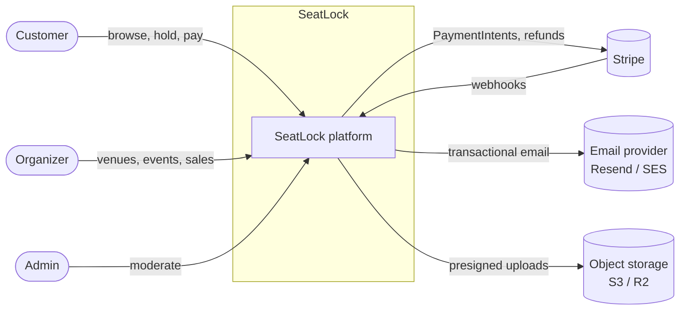
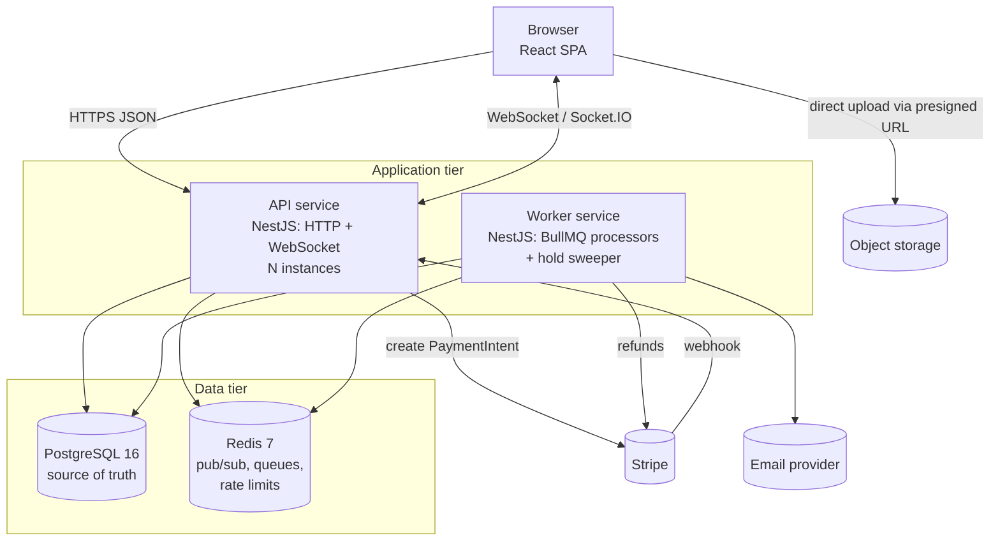
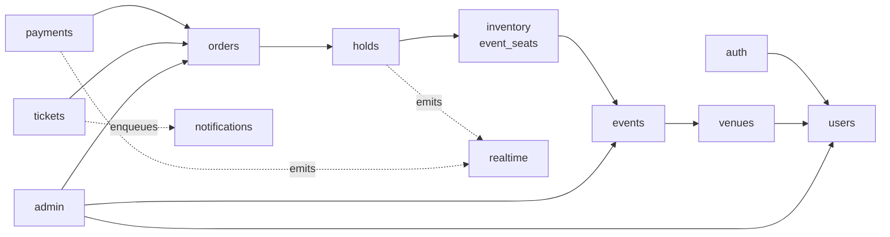
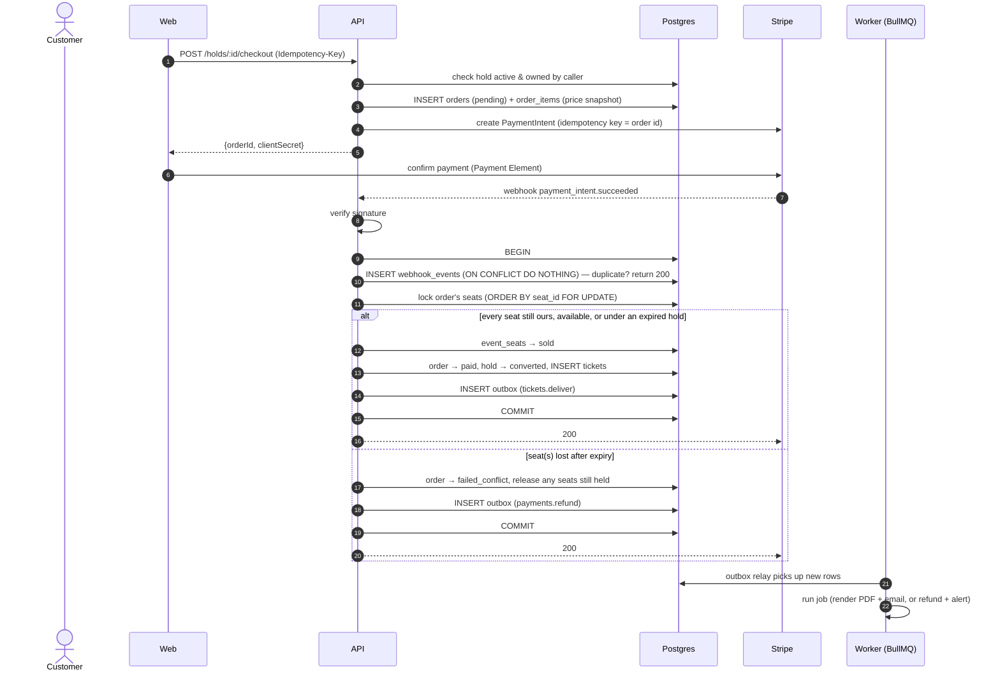

# Architecture — SeatLock

| | |
|---|---|
| **Status** | Approved v1.0 |
| **Related** | [PRD](PRD.md) · [Database](database.md) · [API](api.md) · [ADRs](adr/) · [Wireframes](wireframes.md) |
| **Last updated** | 2026-10-26 |

This document describes how SeatLock is built: the runtime components, how the code is organized, and how the critical flows (hold, checkout, expiry, live updates) work end to end. The reasoning behind each major choice lives in the [ADRs](adr/).

---

## 1. Architectural drivers

These PRD requirements shape the design more than anything else:

| Driver | Consequence for the architecture |
|---|---|
| No double bookings, ever | Seat ownership is decided by Postgres, inside a single conditional `UPDATE` plus constraints. Redis is never the source of truth ([ADR-0004](adr/0004-seat-hold-concurrency.md)). |
| Holds expire automatically | Expiry is computed from timestamps (lazy reclaim). A background sweeper only tidies up; correctness doesn't depend on it running. |
| Live seat map | A WebSocket layer with Redis-backed fan-out, so any API instance can broadcast to any client ([ADR-0006](adr/0006-realtime-socketio-redis-adapter.md)). |
| Reliable payments | Payment state changes only through verified, idempotent Stripe webhooks ([ADR-0009](adr/0009-payments-stripe-payment-intents.md)). |
| Horizontal scaling | API processes are stateless. All shared state lives in Postgres or Redis. |
| Redis outage must not stop sales | Redis carries only optional concerns (fan-out, jobs, rate-limit counters). Booking paths need only Postgres. |

## 2. System context



## 3. Containers (runtime components)



| Component | Responsibility | Scaling |
|---|---|---|
| **Web (SPA)** | All UI. Static files served from a CDN. | CDN |
| **API service** | REST endpoints, WebSocket gateway, Stripe webhook receiver. Enqueues jobs; never does slow work inline. | Horizontal, stateless |
| **Worker service** | Same codebase as the API, started in worker mode. Runs the outbox relay, BullMQ processors (email, PDF tickets, refunds) and the repeatable hold-sweeper job. | Horizontal. BullMQ guarantees each job runs on one worker. |
| **PostgreSQL** | Source of truth for everything, including seat state. | Vertical first; read replicas later if needed |
| **Redis** | Socket.IO adapter (cross-instance fan-out), BullMQ queues, rate-limit counters. Holds no data that can't be lost. | Single managed instance |
| **Stripe** | Card payments and refunds (test mode). | External |
| **Email provider** | Delivers transactional email. Mailpit replaces it in development. | External |
| **Object storage** | Event cover images. RustFS (S3-compatible) replaces it in development. | External |

**Why the worker is a separate process:** slow or failing jobs (PDF rendering, email retries) can never add latency to booking requests, and the two can be scaled independently. It's still one codebase and one Docker image, started with a different entry point.

## 4. Repository layout

A pnpm + Turborepo monorepo ([ADR-0002](adr/0002-monorepo-pnpm-turborepo.md)):

```
seatlock/
├── apps/
│   ├── web/                    # React SPA (Vite)
│   └── api/                    # NestJS: main.ts (API) and worker.ts (worker)
├── packages/
│   ├── shared/                 # zod schemas, DTO types, enums, constants (HOLD_TTL, MAX_SEATS)
│   ├── api-client/             # typed client generated from openapi.yaml
│   ├── eslint-config/
│   └── tsconfig/
├── docs/                       # this folder
├── docker-compose.yml          # postgres, redis, mailpit, rustfs, stripe-cli
├── turbo.json
└── pnpm-workspace.yaml
```

Rule: `apps/*` may depend on `packages/*`; packages never depend on apps; `web` and `api` never import each other.

## 5. Backend design (NestJS)

### 5.1 Modules



| Module | Owns | Notes |
|---|---|---|
| `auth` | Login, refresh rotation, password reset, guards | `JwtAuthGuard`, `RolesGuard`, `@Roles()` decorator |
| `users` | `users`, profile | |
| `venues` | `venues`, `sections`, `seats` | Layout editing is rejected once `layout_locked` is set |
| `events` | `events`, `price_tiers`, publishing | Publishing generates the inventory |
| `inventory` | `event_seats` reads, seat-map snapshot, block/unblock | Seat-map read path is optimized (one query, cached by ETag) |
| `holds` | `holds`, the atomic hold/release SQL, sweeper logic | **The critical module.** Raw SQL, 80%+ test coverage |
| `orders` | `orders`, `order_items` | State machine enforced in one place |
| `payments` | Stripe client, webhook controller, `webhook_events` | Signature verification on the raw request body |
| `tickets` | `tickets`, QR signing (HMAC), PDF generation | |
| `notifications` | Email templates, queue producers and processors | |
| `realtime` | Socket.IO gateway, room management, broadcast service | |
| `admin` | Admin read and search endpoints, moderation actions | |
| `health` | `/health/live`, `/health/ready` | Ready checks Postgres; Redis is reported but not required |

### 5.2 Layering inside a module

```
controller   →  HTTP/WS only: parse and validate input (zod), call service, map to response DTO
service      →  business rules, transactions, state-machine checks, emit domain events
repository   →  data access (Prisma; raw SQL where concurrency matters)
```

Modules communicate through services or in-process domain events (`@nestjs/event-emitter`), never through each other's repositories. Work that must survive a crash, such as "send confirmation email", is written to the `outbox` table **in the same transaction** as the change that caused it. A relay in the worker moves outbox rows into BullMQ ([ADR-0007](adr/0007-background-jobs-bullmq-outbox.md)).

### 5.3 Cross-cutting concerns

| Concern | Approach |
|---|---|
| Validation | zod schemas from `packages/shared`, applied by a global pipe ([ADR-0011](adr/0011-shared-validation-zod.md)) |
| Errors | One global exception filter maps errors to RFC 9457 `application/problem+json` with a stable `code` field |
| Auth | Access JWT in the `Authorization` header; refresh token in an httpOnly cookie ([ADR-0008](adr/0008-auth-jwt-rotating-refresh-tokens.md)) |
| Config | `.env` parsed and validated by zod at boot; the process exits if config is invalid |
| Logging | pino JSON logs; a request ID from `X-Request-Id` (generated if missing) on every log line and error response |
| Metrics | Prometheus `/metrics`: `holds_created_total`, `hold_conflicts_total`, `holds_expired_total`, `payments_total{status}`, HTTP latency histograms |
| Rate limiting | `@nestjs/throttler` with Redis storage, falling back to in-memory if Redis is down. Strict limits on `/auth/*` and `POST /holds`. |
| Idempotency | `Idempotency-Key` header on checkout; Stripe event ID dedup on webhooks |
| Time | All timestamps `timestamptz` in UTC; venues store an IANA time zone; the frontend formats ([ADR-0012](adr/0012-money-and-time-conventions.md)) |
| Money | Integer cents everywhere; single currency (USD) |

## 6. Frontend design

| Concern | Approach |
|---|---|
| Routing | React Router with lazy-loaded route bundles; organizer and admin areas behind role-checked layouts |
| Server state | TanStack Query. Every API response is cached and invalidated by query key. |
| Client state | Component state, plus a small Zustand store for the current seat selection and hold timer |
| API access | `packages/api-client`, generated from `openapi.yaml`, so request and response types always match the contract |
| Realtime | One Socket.IO connection. Seat updates are written directly into the TanStack Query cache for that event's seat map. |
| Forms | react-hook-form with the shared zod schemas, so frontend and backend validation are identical |
| Seat map | SVG; one `<g>` per section; seats are focusable `<button role="checkbox">` elements with ARIA labels such as "Row B seat 12, $45, available" |
| Styling | Tailwind with design tokens for seat-state colours (see [wireframes](wireframes.md#design-tokens)) |
| Testing | Vitest + Testing Library for components; Playwright for E2E |

**Route map**

```
/                          event listing + filters
/events/:id                event detail + seat map
/checkout/:holdId          payment (Stripe Payment Element) + countdown
/orders/:id/confirmation   success page
/me/tickets                my tickets (upcoming / past)
/me/tickets/:id            single ticket with QR code
/login, /register, /forgot-password, /reset-password
/organizer                 dashboard
/organizer/venues[/:id]    venue list / layout builder
/organizer/events[/:id]    event list / editor / stats
/admin/{users,events,orders}
```

## 7. Critical flows

### 7.1 Placing a hold

```mermaid
sequenceDiagram
    autonumber
    actor C as Customer
    participant W as Web
    participant A as API (holds)
    participant P as Postgres
    participant R as Redis
    participant O as Other viewers

    C->>W: select seats, click "Hold"
    W->>A: POST /events/:id/holds {seatIds}
    A->>P: BEGIN
    A->>P: check event on sale; lock caller's previous active hold
    A->>P: lock requested + previously held seats (ORDER BY seat_id FOR UPDATE)
    alt every requested seat is available, expired, or ours
        A->>P: release previous hold; INSERT holds; conditional UPDATE event_seats → held
        A->>P: COMMIT
        A-->>W: 201 {holdId, expiresAt, seats}
        A->>R: publish seats.held (fire-and-forget)
        R-->>O: seat:update via Socket.IO room event:{id}
    else some seats not available
        A->>P: ROLLBACK
        A-->>W: 409 problem+json {code: SEATS_UNAVAILABLE, conflicts:[...]}
        W->>W: refetch seat map, highlight conflicts
    end
```

The full SQL and its proof of correctness are in [database.md §5](database.md#5-concurrency-and-locking).

### 7.2 Checkout and payment



Note that a hold that expired but whose seats nobody else took can still be converted. Expiry only means "the seats may be reclaimed", not "the seats were reclaimed".

### 7.3 Hold expiry

1. **Lazy reclaim (correctness):** the hold `UPDATE` treats `status='held' AND hold_expires_at < now()` as available. A seat is never blocked by a dead hold, even if the sweeper is down.
2. **Sweeper (tidiness):** a BullMQ repeatable job runs every 30 s on one worker:
   ```sql
   UPDATE event_seats SET status='available', hold_id=NULL, hold_expires_at=NULL, version=version+1
   WHERE status='held' AND hold_expires_at < now()
   RETURNING event_id, seat_id;
   ```
   It marks the matching `holds` rows as `expired` and publishes `seats.released` per event. Pending orders whose hold expired, and that have no successful payment, become `expired`.
3. **Client:** the countdown is driven by the server's `expiresAt`, not by a local timer start. When it reaches zero, the UI shows "Hold expired" and refetches the seat map.

### 7.4 Live seat-map updates

```
service commits change ──▶ RealtimeService.broadcast(eventId, changes)
                              │
                              ▼
               Socket.IO server.to(`event:${eventId}`).emit('seat:update', …)
                              │  (Redis adapter fans out to every API instance)
                              ▼
               browsers in room → patch TanStack Query cache by seatId,
                                  ignoring updates whose version ≤ cached version
```

- Broadcasts happen **after** commit, so clients never see uncommitted state.
- Each update carries the seat's `version`, so out-of-order delivery can't move a seat backwards.
- On reconnect, the client refetches the full snapshot (`GET /events/:id/seats`). Socket.IO's long-polling transport covers environments where WebSockets are blocked.
- If Redis is down, broadcasts reach only clients on the same instance. Bookings are unaffected, and the client's 15 s background refetch keeps maps approximately fresh.

## 8. Failure modes

| Failure | Impact | Behaviour |
|---|---|---|
| Redis down | No cross-instance live updates, jobs not dispatched, rate limits fall back to in-memory | Holds, checkout and webhooks keep working. Jobs are already safe in the `outbox` table and are relayed once Redis returns. |
| Worker down | Emails and refunds delayed; sweeper paused | Lazy reclaim keeps seats bookable. Jobs wait in the queue. |
| API instance crash mid-hold | Transaction rolls back | The client retries; no partial holds are possible |
| Stripe webhook delayed | Order stays `pending` | The confirmation page polls `GET /orders/:id`; the webhook eventually settles it |
| Duplicate or out-of-order webhooks | None | Event-ID dedup; state transitions only move forward |
| Payment after seat lost | Customer charged for an unavailable seat | `failed_conflict`, automatic refund, alert, apologetic email |
| Postgres down | Full outage | `/health/ready` fails and the load balancer stops traffic. Managed Postgres with point-in-time recovery. |

## 9. Security

- Passwords hashed with argon2id; login and reset endpoints rate-limited; generic error messages (no user enumeration).
- Access tokens last 15 min. Refresh tokens are rotated on every use and stored hashed; reusing an old one revokes the whole token family.
- Refresh cookie: `HttpOnly; Secure; SameSite=Strict; Path=/api/v1/auth`.
- Authorization is checked in services, not only in guards: an organizer may only touch resources where `organizer_id = currentUser.id`.
- The Stripe webhook verifies the signature against the raw body; the endpoint is excluded from JWT auth and from the JSON body parser.
- QR payload: `ticketId.HMAC-SHA256(ticketId, QR_SECRET)`; checked in constant time.
- Helmet security headers; CORS allows only the web origin; uploads use short-lived presigned URLs with content-type and size limits.
- Secrets come only from environment variables; none are committed. `.env.example` documents every variable.
- Dependency scanning (Dependabot) and `pnpm audit` in CI.

## 10. Environments and deployment

| Environment | Purpose | Infrastructure |
|---|---|---|
| **Local** | Development | `docker compose up`: Postgres, Redis, Mailpit, RustFS (S3-compatible), Stripe CLI (webhook forwarding) |
| **CI** | Every PR | GitHub Actions; Testcontainers for Postgres and Redis |
| **Staging** | Auto-deploy from `main` | Render, defined in `render.yaml` ([ADR-0013](adr/0013-hosting-on-render.md)): static site (web), web service (api), background worker, Render Postgres, Render Key Value; Stripe test mode |
| **Production** | Manual promotion of a tagged release | Same shape as staging |

**Pipeline:** lint → type-check → unit tests → integration tests → build Docker image → run migrations (`prisma migrate deploy`) → deploy API and worker → deploy web → smoke test `/health/ready`.

Migrations must be backward compatible with the previous release (expand → migrate → contract), so the API can roll forward without downtime.

## 11. Capacity assumptions (MVP)

| Metric | Target |
|---|---|
| Largest venue | 2,000 seats |
| Concurrent viewers per hot event | 5,000 |
| Hold requests at an on-sale spike | 200/s on a single event |
| Seat-map snapshot payload | ~60 KB gzipped for 2,000 seats (compact array format, see [api.md](api.md)) |

These numbers will be verified by the k6 load test in M8.
