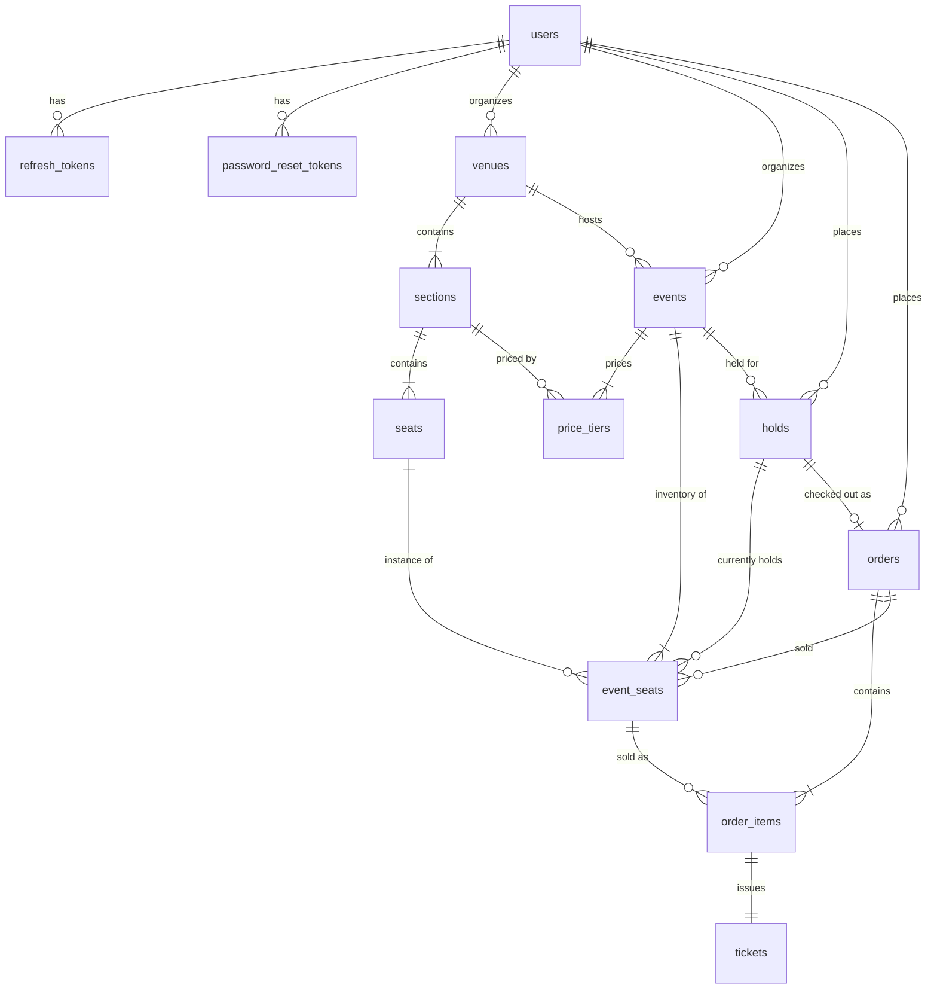

# Database Design — SeatLock

| | |
|---|---|
| **Status** | Approved v1.0 |
| **Engine** | PostgreSQL 16 |
| **Related** | [Architecture](architecture.md) · [ADR-0004 seat-hold concurrency](adr/0004-seat-hold-concurrency.md) · [ADR-0005 Prisma + raw SQL](adr/0005-prisma-with-raw-sql-hot-path.md) · [ADR-0012 money and time](adr/0012-money-and-time-conventions.md) |
| **Last updated** | 2026-10-26 |

This document supersedes the initial data model in [PRD §10](PRD.md#10-data-model-initial). The main additions are: venue time zone, user status, auth token tables, `order_items` (price snapshots), the `outbox`, and an audit log.

---

## 1. Conventions

| Topic | Convention |
|---|---|
| Naming | `snake_case`, plural table names, `<table>_id` for foreign keys |
| Primary keys | `uuid`, generated by the application as **UUIDv7** (time-ordered, so B-tree indexes stay compact). `DEFAULT gen_random_uuid()` is a fallback. |
| Timestamps | `timestamptz` only, stored in UTC. Every table has `created_at`; mutable tables also have `updated_at`, maintained by a trigger. |
| Money | `integer` cents with a `_cents` suffix; single currency (USD) |
| Enums | Postgres `ENUM` types. Adding a value is a migration; values are never removed. |
| Text | `text` with `CHECK (char_length(...) <= n)` rather than `varchar(n)` |
| Email | `citext`, so uniqueness is case-insensitive |
| Deletes | Hard deletes only for draft data. Anything referenced by an order is never deleted; it's cancelled or disabled instead. |
| Constraints | Business invariants that can be expressed in SQL **are** expressed in SQL (CHECK, UNIQUE, partial indexes), not just in application code. |

Required extension: `citext`.

## 2. Entity-relationship diagram



The `outbox`, `webhook_events` and `audit_log` tables are standalone (no foreign keys) so they never block writes to business tables.

## 3. Enum types

```sql
CREATE TYPE user_role      AS ENUM ('customer', 'organizer', 'admin');
CREATE TYPE user_status    AS ENUM ('active', 'disabled');
CREATE TYPE event_status   AS ENUM ('draft', 'published', 'cancelled', 'completed');
CREATE TYPE event_category AS ENUM ('concert', 'movie', 'theatre', 'comedy', 'sports', 'conference', 'other');
CREATE TYPE seat_status    AS ENUM ('available', 'held', 'sold', 'blocked');
CREATE TYPE hold_status    AS ENUM ('active', 'released', 'expired', 'converted');
CREATE TYPE order_status   AS ENUM ('pending', 'paid', 'failed', 'expired', 'failed_conflict', 'refunded');
CREATE TYPE ticket_status  AS ENUM ('valid', 'used', 'cancelled');
```

## 4. Tables

### 4.1 Identity

```sql
CREATE TABLE users (
  id             uuid PRIMARY KEY DEFAULT gen_random_uuid(),
  email          citext NOT NULL UNIQUE,
  password_hash  text   NOT NULL,                          -- argon2id
  name           text   NOT NULL CHECK (char_length(name) BETWEEN 1 AND 100),
  role           user_role   NOT NULL DEFAULT 'customer',
  status         user_status NOT NULL DEFAULT 'active',
  created_at     timestamptz NOT NULL DEFAULT now(),
  updated_at     timestamptz NOT NULL DEFAULT now()
);

CREATE TABLE refresh_tokens (
  id           uuid PRIMARY KEY DEFAULT gen_random_uuid(),
  user_id      uuid NOT NULL REFERENCES users(id) ON DELETE CASCADE,
  family_id    uuid NOT NULL,                              -- all rotations of one login share a family
  token_hash   bytea NOT NULL UNIQUE,                      -- sha256(token); the raw token is never stored
  expires_at   timestamptz NOT NULL,
  revoked_at   timestamptz,
  replaced_by  uuid REFERENCES refresh_tokens(id),
  user_agent   text,
  ip           inet,
  created_at   timestamptz NOT NULL DEFAULT now()
);
CREATE INDEX refresh_tokens_user_idx   ON refresh_tokens (user_id);
CREATE INDEX refresh_tokens_family_idx ON refresh_tokens (family_id);

CREATE TABLE password_reset_tokens (
  id          uuid PRIMARY KEY DEFAULT gen_random_uuid(),
  user_id     uuid NOT NULL REFERENCES users(id) ON DELETE CASCADE,
  token_hash  bytea NOT NULL UNIQUE,
  expires_at  timestamptz NOT NULL,                        -- 30 minutes
  used_at     timestamptz,
  created_at  timestamptz NOT NULL DEFAULT now()
);
```

### 4.2 Venues and layouts

```sql
CREATE TABLE venues (
  id             uuid PRIMARY KEY DEFAULT gen_random_uuid(),
  organizer_id   uuid NOT NULL REFERENCES users(id),
  name           text NOT NULL CHECK (char_length(name) BETWEEN 1 AND 120),
  address_line   text NOT NULL,
  city           text NOT NULL,
  country_code   char(2) NOT NULL,                         -- ISO 3166-1 alpha-2
  timezone       text NOT NULL,                            -- IANA, e.g. 'America/New_York'; validated in the app
  layout_locked  boolean NOT NULL DEFAULT false,           -- set when the first event at this venue is published
  created_at     timestamptz NOT NULL DEFAULT now(),
  updated_at     timestamptz NOT NULL DEFAULT now()
);
CREATE INDEX venues_organizer_idx ON venues (organizer_id);
CREATE INDEX venues_city_idx      ON venues (lower(city));

CREATE TABLE sections (
  id          uuid PRIMARY KEY DEFAULT gen_random_uuid(),
  venue_id    uuid NOT NULL REFERENCES venues(id) ON DELETE CASCADE,
  name        text NOT NULL,
  color       char(7) NOT NULL CHECK (color ~ '^#[0-9A-Fa-f]{6}$'),
  sort_order  integer NOT NULL DEFAULT 0,
  UNIQUE (venue_id, name),
  UNIQUE (id, venue_id)                                    -- target for the composite FK below
);

CREATE TABLE seats (
  id             uuid PRIMARY KEY DEFAULT gen_random_uuid(),
  venue_id       uuid NOT NULL,
  section_id     uuid NOT NULL,
  row_label      text NOT NULL CHECK (char_length(row_label) BETWEEN 1 AND 4),
  seat_number    integer NOT NULL CHECK (seat_number > 0),
  label          text GENERATED ALWAYS AS (row_label || '-' || seat_number) STORED,
  x              integer NOT NULL CHECK (x >= 0),          -- grid units, used for rendering
  y              integer NOT NULL CHECK (y >= 0),
  is_accessible  boolean NOT NULL DEFAULT false,
  FOREIGN KEY (section_id, venue_id) REFERENCES sections (id, venue_id) ON DELETE CASCADE,
  UNIQUE (section_id, row_label, seat_number),
  UNIQUE (venue_id, x, y)                                  -- two seats can't occupy the same grid cell
);
```

- **Gaps** (aisles, pillars) are just grid cells with no seat.
- `seats.venue_id` is deliberately denormalized so overlapping-seat checks and venue-wide queries need no join. The composite foreign key ensures it always matches the section's venue.
- **Layout lock:** set when the first event at the venue is published, because publishing copies the layout into `event_seats`; editing seats afterwards would orphan that inventory. Once `layout_locked` is true, the API rejects every write to `sections` and `seats` for that venue. A `BEFORE INSERT OR UPDATE OR DELETE` trigger on `seats` enforces the same rule in the database as a backstop. To change a locked layout, organizers duplicate the venue.

### 4.3 Events and inventory

```sql
CREATE TABLE events (
  id               uuid PRIMARY KEY DEFAULT gen_random_uuid(),
  organizer_id     uuid NOT NULL REFERENCES users(id),
  venue_id         uuid NOT NULL REFERENCES venues(id),
  title            text NOT NULL CHECK (char_length(title) BETWEEN 1 AND 150),
  description      text NOT NULL DEFAULT '' CHECK (char_length(description) <= 5000),
  category         event_category NOT NULL,
  cover_image_key  text,                                   -- object-storage key, not a URL
  starts_at        timestamptz NOT NULL,
  ends_at          timestamptz NOT NULL,
  status           event_status NOT NULL DEFAULT 'draft',
  published_at     timestamptz,
  cancelled_at     timestamptz,
  search_vector    tsvector GENERATED ALWAYS AS (
                     setweight(to_tsvector('english', title), 'A') ||
                     setweight(to_tsvector('english', description), 'B')
                   ) STORED,
  created_at       timestamptz NOT NULL DEFAULT now(),
  updated_at       timestamptz NOT NULL DEFAULT now(),
  CHECK (ends_at > starts_at),
  CHECK (status <> 'published' OR published_at IS NOT NULL)
);
CREATE INDEX events_listing_idx   ON events (starts_at) WHERE status = 'published';
CREATE INDEX events_organizer_idx ON events (organizer_id, starts_at DESC);
CREATE INDEX events_venue_idx     ON events (venue_id);
CREATE INDEX events_search_idx    ON events USING gin (search_vector);

CREATE TABLE price_tiers (
  id           uuid PRIMARY KEY DEFAULT gen_random_uuid(),
  event_id     uuid NOT NULL REFERENCES events(id) ON DELETE CASCADE,
  section_id   uuid NOT NULL REFERENCES sections(id),
  price_cents  integer NOT NULL CHECK (price_cents BETWEEN 0 AND 1000000),
  UNIQUE (event_id, section_id)
);

CREATE TABLE event_seats (
  id               uuid PRIMARY KEY DEFAULT gen_random_uuid(),
  event_id         uuid NOT NULL REFERENCES events(id),
  seat_id          uuid NOT NULL REFERENCES seats(id),
  section_id       uuid NOT NULL REFERENCES sections(id),  -- denormalized for price lookups and map grouping
  status           seat_status NOT NULL DEFAULT 'available',
  hold_id          uuid REFERENCES holds(id),
  hold_expires_at  timestamptz,
  order_id         uuid REFERENCES orders(id),
  version          integer NOT NULL DEFAULT 0,             -- +1 on every status change; used for realtime ordering
  updated_at       timestamptz NOT NULL DEFAULT now(),
  UNIQUE (event_id, seat_id),
  CONSTRAINT event_seats_state_chk CHECK (
       (status = 'available' AND hold_id IS NULL     AND hold_expires_at IS NULL     AND order_id IS NULL)
    OR (status = 'held'      AND hold_id IS NOT NULL AND hold_expires_at IS NOT NULL AND order_id IS NULL)
    OR (status = 'sold'      AND hold_id IS NULL     AND hold_expires_at IS NULL     AND order_id IS NOT NULL)
    OR (status = 'blocked'   AND hold_id IS NULL     AND hold_expires_at IS NULL     AND order_id IS NULL)
  )
);
CREATE INDEX event_seats_hold_idx    ON event_seats (hold_id) WHERE hold_id IS NOT NULL;
CREATE INDEX event_seats_expiry_idx  ON event_seats (hold_expires_at) WHERE status = 'held';
CREATE INDEX event_seats_status_idx  ON event_seats (event_id, status);
```

(Tables are listed by topic. In the actual migration, `holds` and `orders` are created before `event_seats`.)

- **Inventory generation:** publishing an event runs `INSERT INTO event_seats (event_id, seat_id, section_id) SELECT $event, id, section_id FROM seats WHERE venue_id = $venue` and `UPDATE venues SET layout_locked = true` in the same transaction that sets `status = 'published'`. Publishing fails unless every section has a price tier.
- **Blocking (story O5):** a per-event `status = 'blocked'`. Seats that are permanently unusable simply aren't created in the layout.
- **`event_seats_state_chk`** makes impossible states (such as "sold but no order" or "held with no expiry") unrepresentable.

### 4.4 Holds, orders and tickets

```sql
CREATE TABLE holds (
  id           uuid PRIMARY KEY DEFAULT gen_random_uuid(),
  event_id     uuid NOT NULL REFERENCES events(id),
  user_id      uuid NOT NULL REFERENCES users(id),
  status       hold_status NOT NULL DEFAULT 'active',
  expires_at   timestamptz NOT NULL,
  released_at  timestamptz,
  created_at   timestamptz NOT NULL DEFAULT now()
);
-- PRD 7.4: at most one active hold per customer per event
CREATE UNIQUE INDEX holds_one_active_per_user_event ON holds (user_id, event_id) WHERE status = 'active';
CREATE INDEX holds_expiry_idx ON holds (expires_at) WHERE status = 'active';

CREATE TABLE orders (
  id                        uuid PRIMARY KEY DEFAULT gen_random_uuid(),
  user_id                   uuid NOT NULL REFERENCES users(id),
  event_id                  uuid NOT NULL REFERENCES events(id),
  hold_id                   uuid NOT NULL REFERENCES holds(id),
  status                    order_status NOT NULL DEFAULT 'pending',
  total_cents               integer NOT NULL CHECK (total_cents >= 0),
  stripe_payment_intent_id  text UNIQUE,
  idempotency_key           text NOT NULL,
  paid_at                   timestamptz,
  refunded_at               timestamptz,
  created_at                timestamptz NOT NULL DEFAULT now(),
  updated_at                timestamptz NOT NULL DEFAULT now(),
  UNIQUE (user_id, idempotency_key),
  CHECK (status <> 'paid' OR paid_at IS NOT NULL)
);
-- at most one live order per hold
CREATE UNIQUE INDEX orders_one_live_per_hold ON orders (hold_id) WHERE status IN ('pending', 'paid');
CREATE INDEX orders_user_idx  ON orders (user_id, created_at DESC);
CREATE INDEX orders_event_idx ON orders (event_id, status);

CREATE TABLE order_items (
  id             uuid PRIMARY KEY DEFAULT gen_random_uuid(),
  order_id       uuid NOT NULL REFERENCES orders(id) ON DELETE CASCADE,
  event_seat_id  uuid NOT NULL REFERENCES event_seats(id),
  seat_label     text NOT NULL,                            -- snapshot for receipts and emails
  section_name   text NOT NULL,                            -- snapshot
  price_cents    integer NOT NULL CHECK (price_cents >= 0),-- snapshot (ADR-0012)
  UNIQUE (order_id, event_seat_id)
);

CREATE TABLE tickets (
  id             uuid PRIMARY KEY DEFAULT gen_random_uuid(),
  order_id       uuid NOT NULL REFERENCES orders(id),
  order_item_id  uuid NOT NULL UNIQUE REFERENCES order_items(id),
  event_id       uuid NOT NULL REFERENCES events(id),
  event_seat_id  uuid NOT NULL REFERENCES event_seats(id),
  user_id        uuid NOT NULL REFERENCES users(id),
  code           text NOT NULL UNIQUE,                     -- human-readable, e.g. 'SL-7KQ2-9XPA'
  status         ticket_status NOT NULL DEFAULT 'valid',
  checked_in_at  timestamptz,
  created_at     timestamptz NOT NULL DEFAULT now(),
  CHECK (status <> 'used' OR checked_in_at IS NOT NULL)
);
-- THE double-booking backstop: one non-cancelled ticket per seat per event
CREATE UNIQUE INDEX tickets_one_valid_per_seat ON tickets (event_seat_id) WHERE status <> 'cancelled';
CREATE INDEX tickets_user_idx ON tickets (user_id, created_at DESC);
```

The QR payload is **not stored**. It's derived as `ticketId.base64url(HMAC-SHA256(ticketId, QR_SECRET))`, so a database leak alone can't be used to forge tickets.

### 4.5 Infrastructure tables

```sql
CREATE TABLE webhook_events (
  stripe_event_id  text PRIMARY KEY,                       -- dedup key
  type             text NOT NULL,
  payload          jsonb NOT NULL,
  received_at      timestamptz NOT NULL DEFAULT now(),
  processed_at     timestamptz
);

CREATE TABLE outbox (
  id             uuid PRIMARY KEY DEFAULT gen_random_uuid(),
  type           text NOT NULL,                            -- 'tickets.deliver', 'payments.refund', 'orders.expire', 'email.send'
  payload        jsonb NOT NULL,
  created_at     timestamptz NOT NULL DEFAULT now(),
  dispatched_at  timestamptz
);
CREATE INDEX outbox_pending_idx ON outbox (created_at) WHERE dispatched_at IS NULL;

CREATE TABLE audit_log (
  id           bigint GENERATED ALWAYS AS IDENTITY PRIMARY KEY,
  actor_id     uuid,                                       -- null = system
  action       text NOT NULL,                              -- 'user.disable', 'event.unpublish', 'seat.block', ...
  entity_type  text NOT NULL,
  entity_id    uuid NOT NULL,
  data         jsonb NOT NULL DEFAULT '{}',
  created_at   timestamptz NOT NULL DEFAULT now()
);
CREATE INDEX audit_log_entity_idx ON audit_log (entity_type, entity_id, created_at DESC);
```

## 5. Concurrency and locking

All of this runs at **READ COMMITTED** (Postgres's default). Each statement sees data committed before that statement started, and `SELECT ... FOR UPDATE` always returns the **latest committed** version of a row once it acquires the lock. That second property is what makes the patterns below safe.

**Lock-ordering rule:** any transaction that locks more than one `event_seats` row locks them with `ORDER BY seat_id FOR UPDATE`. Because every transaction acquires locks in the same order, two transactions can't each hold a lock the other is waiting for. As a safety net, the application retries a transaction up to 3 times on `40P01` (deadlock) or `40001` (serialization failure).

### 5.1 Placing a hold

Inputs: `$user`, `$event`, `$seat_ids` (1–10, deduplicated), `$new_hold_id`, `$ttl = '10 minutes'`.

```sql
BEGIN;

-- 1. The event must be on sale. FOR SHARE blocks a concurrent cancel/unpublish until we finish.
SELECT 1 FROM events
WHERE id = $event AND status = 'published' AND starts_at > now()
FOR SHARE;
-- no row → ROLLBACK, 409 EVENT_NOT_ON_SALE

-- 2. Find and lock the caller's current active hold for this event (a new hold replaces it).
SELECT id FROM holds
WHERE user_id = $user AND event_id = $event AND status = 'active'
FOR UPDATE;                                         -- → $old_hold_id (may be NULL)

-- 3. Lock EVERY seat row this transaction will touch, in a fixed order.
SELECT seat_id, status, hold_id, hold_expires_at
FROM event_seats
WHERE event_id = $event
  AND (seat_id = ANY($seat_ids) OR hold_id = $old_hold_id)
ORDER BY seat_id
FOR UPDATE;
-- In the application, each requested seat must exist and be:
--   available, OR held by $old_hold_id, OR held with hold_expires_at < now()
-- Otherwise → ROLLBACK, 409 SEATS_UNAVAILABLE {conflicts: [...]}  (unknown seat ids → 422)

-- 4. Release the previous hold (some of its seats may be re-held in step 5).
UPDATE holds SET status = 'released', released_at = now() WHERE id = $old_hold_id;
UPDATE event_seats
SET status = 'available', hold_id = NULL, hold_expires_at = NULL, version = version + 1, updated_at = now()
WHERE hold_id = $old_hold_id;

-- 5. Create the new hold and claim the seats.
INSERT INTO holds (id, event_id, user_id, status, expires_at)
VALUES ($new_hold_id, $event, $user, 'active', now() + $ttl)
RETURNING expires_at;                               -- → $expires_at

UPDATE event_seats
SET status = 'held', hold_id = $new_hold_id, hold_expires_at = $expires_at,
    version = version + 1, updated_at = now()
WHERE event_id = $event
  AND seat_id = ANY($seat_ids)
  AND (status = 'available' OR (status = 'held' AND hold_expires_at < now()))
RETURNING seat_id, version;
-- rows ≠ cardinality($seat_ids) → ROLLBACK (can't happen while we hold the locks; kept as a guard)

COMMIT;
-- after commit: broadcast seat changes (held / available) with their versions
```

**Why two customers can't both win seat S:**

1. T1 and T2 both reach step 3. T1 locks S first; T2 blocks on S's row lock.
2. T1 marks S `held` and commits, which releases the lock.
3. T2's `FOR UPDATE` now returns the latest committed version of S: `held`, not expired.
4. The application check fails, and T2 rolls back with `409`.

**Why multi-seat holds can't deadlock:** both transactions lock their seats in `seat_id` order (and step 3 includes the old hold's seats in that same ordered lock), so both always request locks in the same sequence.

### 5.2 Checkout

1. **Transaction A:**
   - lock the hold with `FOR UPDATE`; it must belong to the caller, be `active`, and have `expires_at > now() + 60s`
   - if a `pending` order already exists for the hold, return it
   - otherwise insert the order and its `order_items`, with prices copied from `price_tiers`
   - commit
2. **Outside any transaction:** create the Stripe PaymentIntent with `idempotency_key = order.id`. Network calls are never made while holding row locks.
3. **Transaction B:** set `orders.stripe_payment_intent_id`.

If the process crashes between steps, a retry finds the pending order, and Stripe's idempotency key returns the same PaymentIntent.

### 5.3 Fulfilment (webhook `payment_intent.succeeded`)

```sql
BEGIN;
INSERT INTO webhook_events (stripe_event_id, type, payload) VALUES (...)
ON CONFLICT DO NOTHING RETURNING 1;                 -- no row → duplicate → COMMIT, return 200

SELECT * FROM orders WHERE id = $order FOR UPDATE;  -- must be 'pending' (forward-only); otherwise no-op

SELECT es.id, es.status, es.hold_id, es.hold_expires_at
FROM event_seats es JOIN order_items oi ON oi.event_seat_id = es.id
WHERE oi.order_id = $order
ORDER BY es.seat_id
FOR UPDATE;
-- Each seat is still claimable if it is: held by this order's hold, OR available,
-- OR held by another hold that has expired.

-- all claimable:
UPDATE event_seats SET status = 'sold', order_id = $order, hold_id = NULL, hold_expires_at = NULL,
       version = version + 1, updated_at = now()
WHERE id = ANY($event_seat_ids);
UPDATE orders  SET status = 'paid', paid_at = now() WHERE id = $order;
UPDATE holds   SET status = 'converted' WHERE id = $hold;
INSERT INTO tickets (...) SELECT ... FROM order_items WHERE order_id = $order;
INSERT INTO outbox (type, payload) VALUES ('tickets.deliver', jsonb_build_object('orderId', $order));

-- any seat not claimable:
UPDATE event_seats SET status = 'available', hold_id = NULL, hold_expires_at = NULL, version = version + 1
WHERE hold_id = $hold;                              -- release whatever we still hold
UPDATE orders SET status = 'failed_conflict' WHERE id = $order;
INSERT INTO outbox (type, payload) VALUES ('payments.refund', jsonb_build_object('orderId', $order));

UPDATE webhook_events SET processed_at = now() WHERE stripe_event_id = $evt;
COMMIT;
```

Accepting seats that are `available` or held by an expired hold means a slow payment only fails if someone **actually took** the seat in the meantime, not just because the timer ran out.

### 5.4 Sweeper (every 30 s)

```sql
-- seats: SKIP LOCKED means the sweeper never waits on, or deadlocks with, live bookings
WITH expired AS (
  SELECT id FROM event_seats
  WHERE status = 'held' AND hold_expires_at < now()
  ORDER BY id
  LIMIT 1000
  FOR UPDATE SKIP LOCKED
)
UPDATE event_seats es
SET status = 'available', hold_id = NULL, hold_expires_at = NULL, version = version + 1, updated_at = now()
FROM expired WHERE es.id = expired.id
RETURNING es.event_id, es.seat_id, es.version;      -- → broadcast per event

UPDATE holds SET status = 'expired'
WHERE status = 'active' AND expires_at < now();

-- pending orders whose hold expired more than 5 minutes ago: cancel the PaymentIntent, then mark expired
INSERT INTO outbox (type, payload)
SELECT 'orders.expire', jsonb_build_object('orderId', o.id)
FROM orders o JOIN holds h ON h.id = o.hold_id
WHERE o.status = 'pending' AND h.expires_at < now() - interval '5 minutes';
```

The `orders.expire` job first cancels the PaymentIntent. If Stripe reports that the payment has already succeeded, the job leaves the order alone, and the webhook settles it. Because jobs are deduplicated by order ID, re-queuing the same order on every sweep is harmless.

### 5.5 Seat-map snapshot read

Expired holds are shown as available even before the sweeper runs:

```sql
SELECT s.id, es.section_id, s.row_label, s.seat_number, s.x, s.y, s.is_accessible,
       CASE WHEN es.status = 'held' AND es.hold_expires_at < now() THEN 'available'
            ELSE es.status END AS status,
       es.version
FROM event_seats es
JOIN seats s ON s.id = es.seat_id
WHERE es.event_id = $event;
```

For 2,000 seats this is a single index scan on `UNIQUE (event_id, seat_id)` plus primary-key lookups. The static layout (positions, labels) is cacheable separately from statuses; see [api.md](api.md).

## 6. Invariants and where they are enforced

| Invariant | Database | Application |
|---|---|---|
| A seat is sold at most once per event | `tickets_one_valid_per_seat`, `event_seats_state_chk` | Fulfilment checks |
| A held seat always has an owner and expiry | `event_seats_state_chk` | |
| One active hold per user per event | `holds_one_active_per_user_event` | Replace semantics in §5.1 |
| One live order per hold | `orders_one_live_per_hold` | Checkout returns the existing order |
| Webhook processed once | `webhook_events` primary key | |
| Seat belongs to the section's venue | Composite foreign key on `seats` | |
| No overlapping seats in a layout | `UNIQUE (venue_id, x, y)` | Builder UI validation |
| Layout frozen after first publish | Trigger on `seats` | Venues service |
| Max 10 seats per hold | | zod schema (shared) |
| Order state only moves forward | | Order state machine in `orders` service |

## 7. Migrations

- **Tool:** Prisma Migrate. Each migration is a committed SQL file under `apps/api/prisma/migrations/`, reviewed like code.
- **Hand-written SQL** (partial indexes, CHECK constraints, triggers, generated columns) is added to the generated migration file and marked `-- manual:` so it isn't lost when migrations are regenerated.
- **Zero-downtime rule (expand → migrate → contract):** add new nullable columns or tables first, deploy code that writes both shapes, backfill, then remove the old shape in a later release. Never rename a column in one step.
- **Large indexes** are built with `CREATE INDEX CONCURRENTLY` in their own migration, outside a transaction.
- **CI** runs `prisma migrate deploy` against a fresh database, then against a copy of the previous release's schema with seed data.

## 8. Seed data (development and staging)

| Data | Contents |
|---|---|
| Users | `admin@seatlock.dev`, `organizer@seatlock.dev`, `customer1..5@seatlock.dev` (password `Password123!`) |
| Venues | "Riverside Cinema" (120 seats, 1 section), "Grand Hall" (1,200 seats, 4 sections), "Arena North" (2,000 seats, 6 sections: the performance test case) |
| Events | 12 published events over the next 60 days across categories and cities; 1 draft; 1 past (completed) |
| Inventory | A few seats pre-sold and blocked, so seat maps show every state |

The seed script is idempotent (it upserts by fixed UUIDs) and refuses to run when `NODE_ENV=production`.

## 9. Data retention and housekeeping

A daily job handles cleanup:

| Data | Retention |
|---|---|
| `outbox` rows with `dispatched_at` set | 7 days |
| `webhook_events` | `payload` cleared after 90 days; IDs kept |
| `refresh_tokens` | deleted 30 days after expiry or revocation |
| `password_reset_tokens` | deleted after 1 day |
| `holds` with status `released` or `expired` | 30 days, unless referenced by an order |
| `audit_log` | kept indefinitely |

## 10. Backups

The managed Postgres provides daily snapshots and point-in-time recovery (7-day window on staging, 30 days on production). Restoring a backup into a scratch database is practised once per milestone from M6 onwards.
